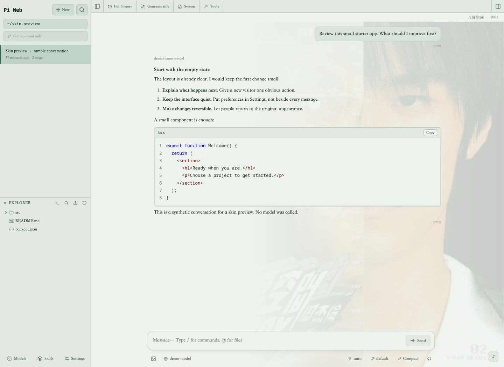
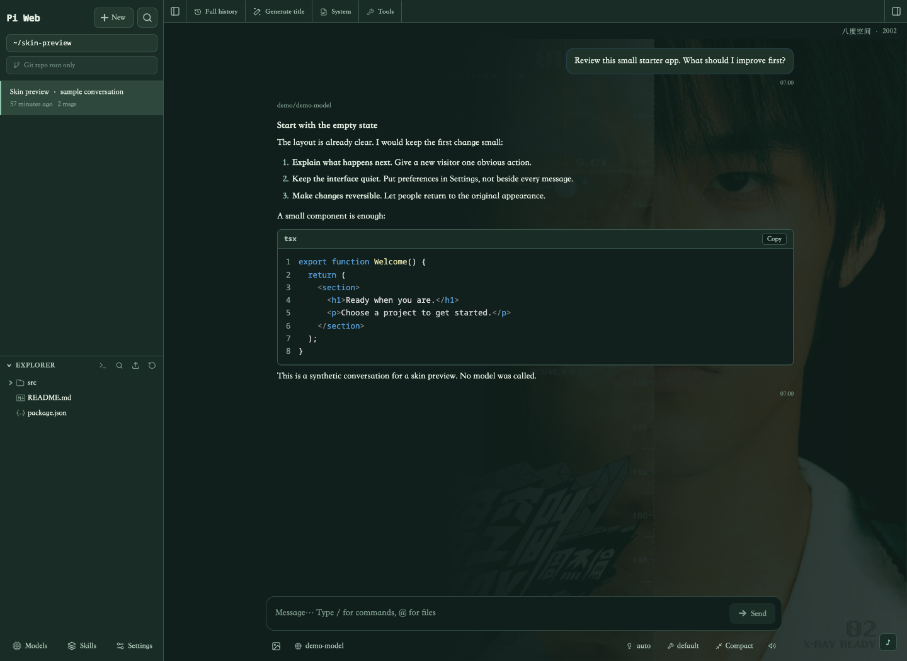
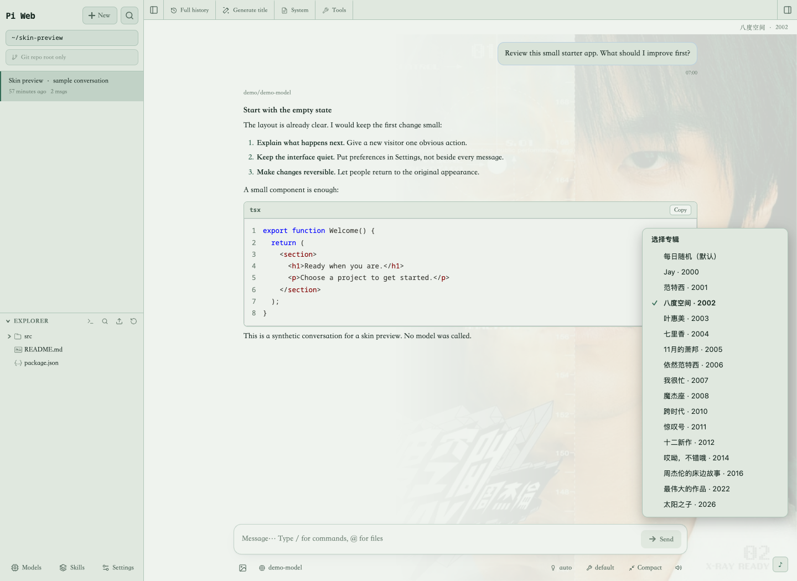

# Proposal: opt-in external skin packs

**Status: an implemented local skin, proposed upstream extension point. This branch does not implement the upstream loader or publish an installable album-art package.**

## Actual result — not a mockup

These screenshots show the installed Pi Web UI with the existing **Jay Chou / 周杰伦 album-inspired skin**, including its revised bottom-right selector. Only the conversation, project and file-list data have been replaced with synthetic API fixtures for privacy. The UI and skin rendering are real; no model was called and no private session was used.

### 八度空间 / The Eight Dimensions — light

### 八度空间 / The Eight Dimensions — dark

### Optional selector — bottom right, opening upward

The local collection has 16 palettes, light/dark variants, remembered manual selection and a daily-shuffle mode. Those existing local features demonstrate the use case; they do **not** all become requirements for an upstream PR.

## Why propose a loading point?

The local implementation patches compiled bundles and is tied to a particular build. It works for personal use, but a supported, optional loading point would avoid patching build outputs after upgrades. Skin authors, not Pi Web maintainers, could own personal artwork and collections.

## Smallest useful scope to discuss

- Explicit user opt-in. Preserve the selected built-in appearance and load no skin-pack assets when disabled.
- A versioned, declarative manifest: allowlisted color tokens and, if acceptable, a bounded local raster decoration rendered by the host. No arbitrary CSS/JS/HTML, remote asset URLs or automatic code execution.
- Independent packs. No album collection or uncleared third-party artwork in the upstream package; an implementation PR would use an original neutral fixture.
- Browser-persisted selection and clean fallback when disabled, removed or invalid. Do not alter sessions, models or credentials.
- No permanent chat-toolbar control. The local example's small bottom-right selector is shown as an optional, skin-enabled interaction; it is not a request to merge its current DOM-injection implementation. Keep installation/enabling in the existing settings flow and agree any optional quick-selection UI with maintainers.

Discovery/installation is intentionally not prescribed. Reuse an existing resource mechanism only if maintainers consider it appropriate; do not invent a parallel package manager or Pi extension API. Daily rotation, a marketplace and layout replacement are outside the first PR.

## Prior discussion

- [#322](https://github.com/agegr/pi-web/pull/322): more built-in palettes were declined at the time.
- [#384](https://github.com/agegr/pi-web/pull/384): a CLI-theme loader was declined for complexity.
- [#772](https://github.com/agegr/pi-web/pull/772): appearance controls were kept in Settings.
- The reviewed source already includes light/dark/mist/rose/pine/system choices. Those built-in choices are not replaced.

Optional does not mean maintenance-free. This proposal asks whether even a narrower loading point fits the project before starting a code PR.

## Screenshot provenance and rights

- Captured from the actual installed Pi Web + skin in a fresh headless browser profile, using real static assets and synthetic responses for **every** application API. No production browser cookies or conversation data.
- Actual served bundle hash was verified against disk. Captures are 1440 × 1050, with no image metadata, JavaScript page errors or console errors in this run.
- The selector was checked at 1440 × 1050, 1024 × 768, 390 × 844 and 844 × 390: in viewport, opens upward, avoids the input and Send button. Actual phone software-keyboard behavior is not verified by these desktop viewport tests.
- **The background album artwork remains third-party copyrighted material. No album-art redistribution licence has been obtained or is implied.** These screenshots document the local prototype; they are not a reusable art pack. Album artwork visible in `screenshots/` is excluded from this repository's MIT grant. Do not extract or redistribute it as theme assets without permission.
- No original cover-image files, embedded-art CSS, compiled bundles, credentials or machine paths are published by this branch.

The earlier `concept.html` / `concept.png` remains as a clearly labelled neutral design illustration, not the primary evidence. Its original CSS decoration is distinct from the real skin screenshots.

## Future loader verification, if accepted

The following are planned checks, **not tests already passed by an upstream loader**:

- Existing palettes/system mode/first paint remain correct.
- No skin assets while disabled; persistence and missing/invalid/removed-pack recovery.
- Path containment, symlink escape, file-size limits, malformed colors, executable content and remote-asset rejection.
- Contrast, Markdown/code/diffs, dialogs, mobile layout, keyboard controls, reduced motion and unavailable storage.
- Repository test, TypeScript and lint checks for the eventual implementation.
