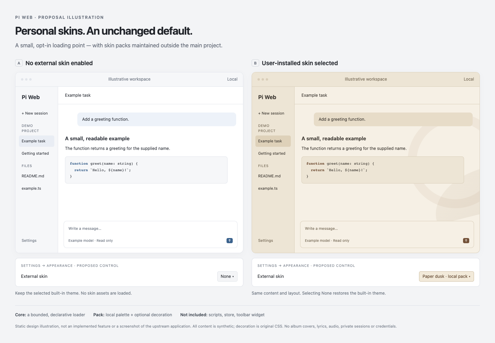

# Proposal: opt-in external skin packs

**Status: design discussion only. No loader or installable skin package is implemented by this branch.**

This branch contains only a static concept illustration for an upstream feature proposal. It does not change Pi Web's application code, defaults or dependencies.

## Motivation

A locally used, album-inspired skin works visually, but its current implementation patches compiled bundles and is tied to a particular build. A supported, optional loading point could remove that upgrade hazard without making maintainers ship or curate personal artwork.

## Smallest useful scope to discuss

- Explicit user opt-in. Preserve the selected built-in appearance when no external skin is enabled; load no external pack assets in that state.
- A locally installed, versioned, declarative manifest: allowlisted color tokens and, if acceptable, a bounded local raster decoration rendered by the host. No arbitrary CSS, JavaScript, HTML, remote URLs or automatic package execution.
- Use Settings → Appearance. No floating switcher or new chat-toolbar control.
- Remember the selection in the browser. Disable/remove/invalid-pack handling clears skin overrides and restores the selected built-in appearance without changing sessions, models or credentials.
- Packs remain independently distributed and maintained. The first PR would include only an original, neutral test fixture, not an album collection.

Installation/discovery and whether decorative images belong in the first version remain open questions. Reuse an existing package resource mechanism only if the maintainers consider that appropriate; do not create a parallel extension API or package manager by default.

Daily rotation, a marketplace, executable theme plugins, layout changes and bundled celebrity artwork are out of scope for the first PR. The existing local skin's daily rotation does not become an upstream requirement.

## Prior discussion

- [#322](https://github.com/agegr/pi-web/pull/322): more built-in palettes were declined at the time.
- [#384](https://github.com/agegr/pi-web/pull/384): a CLI-theme loader was declined for complexity.
- [#772](https://github.com/agegr/pi-web/pull/772): appearance controls were kept in Settings.
- The reviewed upstream source includes light/dark/mist/rose/pine/system choices. Those existing choices are not replaced by this proposal.

Opt-in does not eliminate maintenance cost. The first question is whether even this narrower extension point fits the project; implementation should follow that decision.

## Illustration

`concept.html` is a standalone, static design mockup, **not the real upstream UI or a working loader demo**. Text and file names are synthetic; shapes are original CSS gradients/borders. It contains no official album art, artist likenesses, lyrics, music, private sessions, provider details, credentials or absolute machine paths. The external-skin controls pictured are proposed, not functional.

Open `concept.html` in a browser, or capture it at 1440 × 1000 with a fresh headless browser profile. Its CSP disables scripts and network connections. The HTML and rendered PNG are made available under this repository's MIT license; no rights to third-party album artwork are implied.

## Future verification, if scope is accepted

These are proposed checks, **not tests already run against a loader**:

- Existing palettes, system mode and first-paint initialization remain correct.
- No pack assets are fetched while disabled; selection survives refresh; missing/invalid/removed packs recover cleanly.
- Reject path traversal and symlinks outside the selected pack root, oversized files, malformed colors, executable content and remote assets.
- Check contrast, Markdown/code/diffs, dialogs, mobile layout, keyboard controls, reduced motion and storage-unavailable behavior.
- Follow the repository's `npm test`, TypeScript and lint checks for implementation changes.
